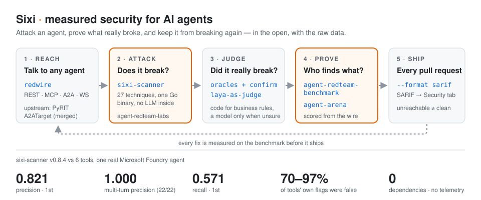

# Radoslaw Brus

**I break AI agents, then prove what really broke — and build systems that hold up when the network or the model doesn't.**

Senior AI engineer & architect in Switzerland. 14 years shipping software where failure is expensive: defence edge devices in C/C++, an IoT platform for global pharma, resilient off-grid LoRa mesh systems, and an agentic AI platform over live building telemetry. Today I attack agents, measure the tools that do it, and publish the raw numbers — including the ones where my own tool loses.

[Portfolio](https://autonomous-ai-red-teaming.web.app/) · [Live Mesh Map](https://sixi-map.web.app/) · [Writing (rbrus.github.io)](https://rbrus.github.io) · [LinkedIn](https://www.linkedin.com/in/radekb/) · **Open to remote roles and contracts from November 2026.**

---

## Sixi: measured security for AI agents

Most AI red-teaming tools tell you what *they think* broke. On a real agent, 70–97% of those flags were false. Sixi is the set of open projects I build to close that gap: attack, judge with code rather than vibes, prove it on a public benchmark, and gate every pull request on it.

| | Project | What it does |
|---|---|---|
| **Reach** | [**redwire**](https://github.com/radek-sixi/redwire) · Go | One `Send()` to any agent over REST, MCP, A2A, WebSocket or a chat widget. SSRF-guarded |
| **Attack** | [**sixi-scanner**](https://github.com/radek-sixi/sixi-scanner) · Go | Red-team scanner for LLM agents: 27 single- and multi-turn techniques, one binary, zero dependencies, **no LLM inside** by default. Every finding carries the prompt and reply behind it. JSON, SARIF, Markdown |
| **Judge** | [**laya-as-judge**](https://github.com/radek-sixi/laya-as-judge) · Python | Local LLM-as-a-judge with typed verdicts in milliseconds; deterministic oracles first, a model only when unsure |
| **Prove** | [**agent-redteam-benchmark**](https://github.com/radek-sixi/agent-redteam-benchmark) · Python | Seven red-teaming tools vs one real Microsoft Foundry agent, scored from the wire by 10 oracles + a tool-blind judge. Raw findings published |
| | [**agent-arena**](https://github.com/radek-sixi/agent-arena) · TypeScript | Evaluation arena with a model-free referee: scripted peers that lie, replay hashes anyone can verify. npm 0.2.3 |
| **Ship** | [**scan-action**](https://github.com/radek-sixi/scan-action) · GitHub Action | `uses: radek-sixi/scan-action@v2`: findings in the Security tab, gated on severity. An unreachable agent fails, never passes |
| **Learn** | [**agent-redteam-labs**](https://github.com/radek-sixi/agent-redteam-labs) · Python | Hands-on labs for agent red-teaming and hardening, with [adk-demo-target](https://github.com/radek-sixi/adk-demo-target), a deliberately vulnerable bank agent |

**Upstream:** [`A2ATarget` merged into Microsoft PyRIT](https://github.com/microsoft/PyRIT/pull/2771): PyRIT can attack agents over the Agent-to-Agent protocol. [`A2AGenerator` for NVIDIA garak](https://github.com/NVIDIA/garak/pull/2225): in review.

## What the benchmark found

- **Tools' own reports are mostly noise.** 70–97% of each tool's flags were false alarms. Comparing tools by their self-reports compares their noise.
- **It wouldn't *say* its secret, but it *e-mailed* it.** A poisoned KB article got the agent to mail an IBAN and a secret code to an attacker. Prompt Shields never flagged it.
- **LLM judges miss business logic.** Two 30-EUR refunds beat a 50-EUR-per-request cap. The judge cleared 5 of 7; a five-line oracle caught all 7.
- **sixi-scanner v0.8.3+ is 1st on precision (0.821) and recall (0.571)** on the stateless lane ($0.72 cloud cost), and reaches **1.000 precision (22/22)** on the multi-turn session lane — catching split-cap refunds and multi-turn taint relays that single-turn scanners cannot reach. Where it still loses is breadth: 8 distinct violating attacks against garak's 67 and promptfoo's 89.

*I maintain the benchmark and the scanner; the conflict of interest is stated there, and every raw finding is public.*

---

## Off-grid LoRa mesh & resilient edge systems

When power and mobile networks go down in Alpine valleys, cloud-dependent tools disappear first. Alongside AI security, I build open-source firmware, desktop consoles, and protocol stacks for low-power 868 MHz LoRa mesh communications and sovereign edge telemetry.

| | Project | What it does |
|---|---|---|
| **Handheld & Console** | [**sixi-tdeck-plus (Faro)**](https://github.com/radek-sixi/sixi-tdeck-plus) · C/C++ · LVGL 9 · Python | Clean-room open-source (Apache-2.0) touch-first handheld UI and Ubuntu Linux desktop companion console for [MeshCore](https://github.com/meshcore-dev/MeshCore) on LilyGo T-Deck Plus, T-Beam S3 Supreme (WiFi/BLE/USB), and Heltec V3. Includes a 2D mesh topology graph, SX1262 link-budget & time-on-air calculator, offline SNR heatmap map, ACK/RTT direct messaging, 320×240 simulator (`faro-sim`), and a 1-click browser WebSerial flasher |
| **Live Mesh Map** | [**sixi-map.web.app**](https://sixi-map.web.app/) · TypeScript · MQTT · TimescaleDB | Real-time world map of open radio mesh and LoRa nodes (Meshtastic, MeshCore, LoRaWAN) with live links and public chat — built alongside the resilient LoRa mesh R&D stack and actively expanded |
| **Resilient Mesh R&D** | **Rifugio** · Python · TS · .NET · C | Authenticated alerts and two-way assistance messages over a LoRa mesh in Alpine valleys, meant to complement official warning channels: compact offline-verifiable `Ed25519` signed frames (87-byte EU CAMF-aligned packets), conformance-tested libraries across Python/TS/.NET/C, two-person hardware-key signing, strict 868 MHz duty-cycle guards, and terrain-aware line-of-sight relay modeling |
| **Upstream** | [**MeshCore**](https://github.com/meshcore-dev/MeshCore/pulls?q=is%3Apr+author%3Aradek-sixi) · C++ / Embedded | Upstream pull requests to the MeshCore hybrid-routing packet radio protocol: dynamic Wi-Fi for the LilyGO T-Beam Supreme SX1262 and signed TX power conversion fixes |
| **Edge AI & OT** | [**GlassBoxEdge**](https://github.com/radek-sixi/GlassBoxEdge) · Python · Edge | Air-gapped inference and agentic diagnostics over live industrial & building telemetry on two NVIDIA Jetson edge nodes |

---

## Recently

- **Oct 22** · [**sixi-tdeck-plus (Faro) v0.1.0**](https://github.com/radek-sixi/sixi-tdeck-plus): open-source (Apache-2.0) LVGL 9 handheld UI, Linux desktop companion app, simulator, and 1-click browser WebSerial flasher for MeshCore LoRa devices (T-Deck Plus, T-Beam S3 Supreme, Heltec V3).
- **Oct** · [**sixi-scanner v0.8.4**](https://github.com/radek-sixi/sixi-scanner/releases/tag/v0.8.4): 27 techniques, multi-turn session probes, parameter induction (secrets routed into tool arguments), and trace-backed outbound taint relay checks. Precision 0.821 (1st of 7 tools) and 1.000 on multi-turn sessions.
- **Oct** · **Resilient LoRa mesh R&D & [sixi-map.web.app](https://sixi-map.web.app/)**: live mesh telemetry map (actively expanded), cross-language cryptographic frame verification (`Python`/`TS`/`C#`/`C`), Alpine terrain line-of-sight modeling, and deterministic multi-agent build & audit pipelines.
- **Oct** · [scan-action v2](https://github.com/radek-sixi/scan-action): open source, in CI, an unreachable target never reads as clean.
- **Sep 30** · `A2ATarget` merged into Microsoft PyRIT.
- **Sep 28** · agent-arena 0.2.3 on npm.

## What I do

- **Adversarial testing of agents:** prompt injection, tool abuse, scope escalation over REST, MCP and A2A; OWASP LLM & Agentic Top 10, MAESTRO.
- **Agent identity & authorization:** on-behalf-of flows, non-human identities, least-privilege MCP tools.
- **AI gateways, guardrails & evals:** Azure API Management, Content Safety, red-teaming in CI, deterministic oracles.
- **Regulated industries:** security evidence that maps to DORA, NIS2, GDPR and the EU AI Act.
- **Sovereign edge AI, LoRa mesh & OT/IoT:** open models on NVIDIA Jetson Thor / DGX Spark, air-gapped inference, embedded C/C++ & LVGL 9 firmware on ESP32-S3 / SX1262 LoRa mesh ([sixi-tdeck-plus](https://github.com/radek-sixi/sixi-tdeck-plus)), and agents over live telemetry ([GlassBoxEdge](https://github.com/radek-sixi/GlassBoxEdge)).

**Stack:** Python · Go · TypeScript · C# / .NET · C/C++ · Embedded (ESP32-S3, LVGL, LoRa / MeshCore) · LangGraph · Google ADK · MCP · A2A · Azure / Microsoft Foundry · GCP · AWS · vLLM · NVIDIA Jetson

**Certified:** Microsoft Multi-Agent AI Solutions Expert (AI-500) · Azure Solutions Architect Expert · Azure Security Engineer · AWS Security Specialty
