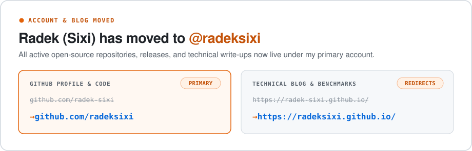

<a href="https://github.com/radeksixi">
  
</a>

<br>

> [!IMPORTANT]
> **I have moved my primary GitHub account to [`@radeksixi`](https://github.com/radeksixi) and my blog to [`https://radeksixi.github.io/`](https://radeksixi.github.io/).**
>
> All active open-source projects, releases, benchmarks, and technical write-ups are maintained under **[`@radeksixi`](https://github.com/radeksixi)**. This `@radek-sixi` account is kept only as a secondary account and signpost.

### Where to find everything now

| Destination | Previous Address | New Primary Address |
| :--- | :--- | :--- |
| **GitHub Profile & Repositories** | `https://github.com/radek-sixi` | **[github.com/radeksixi →](https://github.com/radeksixi)** |
| **Technical Blog & Write-ups** | `https://radek-sixi.github.io/` | **[radeksixi.github.io →](https://radeksixi.github.io/)** |
| **Portfolio** | — | **[radeksixi.web.app →](https://radeksixi.web.app/)** |

### Updating bookmarks & Git remotes

- **Blog links:** Visiting `https://radek-sixi.github.io/` (including direct links to individual posts) automatically redirects to the corresponding page on **[`https://radeksixi.github.io/`](https://radeksixi.github.io/)**.
- **Repository clones:** Existing `github.com/radek-sixi/<repo>` URLs redirect automatically, but it is recommended to update local clones to point directly to `radeksixi`:

```sh
git remote set-url origin https://github.com/radeksixi/<repo>.git
```
